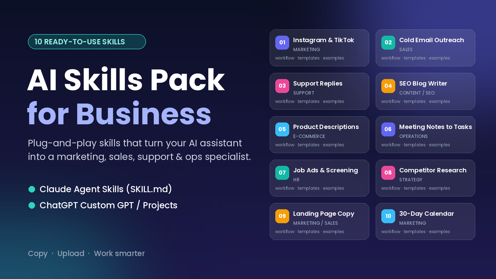

# AI Skills for Business - free sample



**Ready-made AI assistant skills for everyday business work.** Each skill is a carefully structured set of instructions that turns Claude or ChatGPT into a focused specialist: it asks for the right inputs, follows a clear workflow, uses fixed output templates, and checks its own work before answering.

This repo has **3 free skills** from the full **AI Skills Pack for Business (10 skills)**. Use them, fork them, change them for your team.

> **Full pack (10 skills, $8): https://www.patreon.com/DmitryZhuk/posts/ai-skills-pack-173304384**

## What's inside

| Skill | Area | Claude skill folder | Claude upload zip | ChatGPT version |
|---|---|---|---|---|
| **Customer Support Reply Writer** | Support | [`skills/customer-support-replies`](skills/customer-support-replies/SKILL.md) | [`zips/customer-support-replies.zip`](zips/customer-support-replies.zip) | [`chatgpt/customer-support-replies.md`](chatgpt/customer-support-replies.md) |
| **Meeting Notes -> Action Items** | Operations | [`skills/meeting-notes-to-actions`](skills/meeting-notes-to-actions/SKILL.md) | [`zips/meeting-notes-to-actions.zip`](zips/meeting-notes-to-actions.zip) | [`chatgpt/meeting-notes-to-actions.md`](chatgpt/meeting-notes-to-actions.md) |
| **E-commerce Product Description Writer** | E-commerce | [`skills/product-description-writer`](skills/product-description-writer/SKILL.md) | [`zips/product-description-writer.zip`](zips/product-description-writer.zip) | [`chatgpt/product-description-writer.md`](chatgpt/product-description-writer.md) |

Every skill includes:
- a `SKILL.md` in the [Agent Skills](https://claude.com/docs/skills/how-to) format (YAML frontmatter with `name` + `description`, then instructions)
- step-by-step workflow, writing rules, output templates, a worked example and a quality checklist
- a ChatGPT version with Custom GPT setup (name, description, conversation starters, instructions under the 8,000-character limit)
- placeholders like `[CONFIRM: ...]` where a fact must come from you, so the AI does not make things up

## Install in Claude (claude.ai / Claude desktop)

Skills work on Free, Pro, Max, Team and Enterprise plans (check your plan's current options).

1. Turn on code execution: **Settings > Capabilities > Code execution and file creation**.
2. Download the skill zip from [`zips/`](zips/) (or zip a folder from `skills/` yourself; the zip must contain the folder, e.g. `customer-support-replies/SKILL.md`).
3. Go to **Customize > Skills**, click **+**, choose **Create skill > Upload a skill**, and pick the zip.
4. Toggle the skill on. Then just ask, e.g. *"Here's an angry customer email, draft a reply"*. Claude loads the skill on its own when your request matches.

**Claude Code:** copy a folder from `skills/` into `~/.claude/skills/` (personal) or `.claude/skills/` in your project.

```bash
git clone https://github.com/aiskillsdrop/ai-skills-for-business.git
cp -r ai-skills-for-business/skills/* ~/.claude/skills/
```

## Use in ChatGPT

1. Open the file in [`chatgpt/`](chatgpt/).
2. ChatGPT > **Explore GPTs > Create > Configure** (or a **Project > Instructions**).
3. Paste the name, description and conversation starters, then everything between `=== INSTRUCTIONS START ===` and `=== INSTRUCTIONS END ===` into **Instructions**.
4. Save. You can also paste the instructions at the start of any chat.

Works the same way in other assistants that take a system prompt (Gemini Gems, Copilot, Perplexity Spaces, and so on).

## Customise it
Add your brand voice, policies, prices and product facts at the end of a `SKILL.md` (or the GPT instructions). The more real context you add, the better the output.

## The full pack: 10 skills

- Instagram & TikTok Content Strategist (Marketing)
- Cold Email & Sales Outreach Writer (Sales)
- Customer Support Reply Writer (Support)  - *free here*
- SEO Blog Article Writer (Content / SEO)
- E-commerce Product Description Writer (E-commerce)  - *free here*
- Meeting Notes -> Action Items (Operations)  - *free here*
- Job Ad Writer + Resume Screener (HR)
- Market & Competitor Research Analyst (Strategy)
- Landing Page Copywriter (Marketing / Sales)
- 30-Day Social Media Content Calendar (Marketing)

Plus a PDF quick-start guide and one-click zips for every skill.
**Get it here: https://www.patreon.com/DmitryZhuk/posts/ai-skills-pack-173304384**

## License
The free skills in this repo are under the [MIT License](LICENSE).

*Not affiliated with Anthropic or OpenAI. Claude and ChatGPT are trademarks of their owners. AI output can be wrong. Review it before you send or publish, especially for HR, legal or customer-facing use.*
